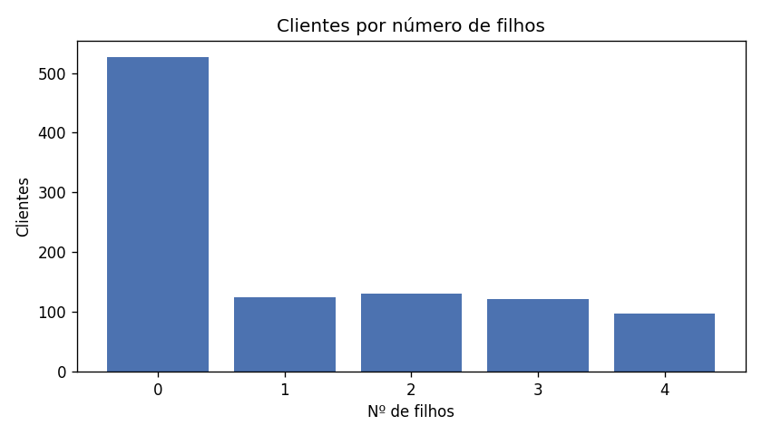
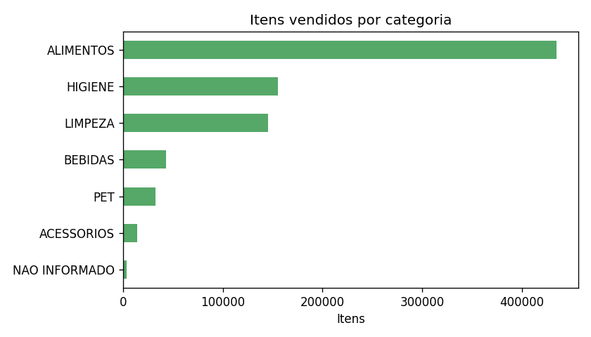
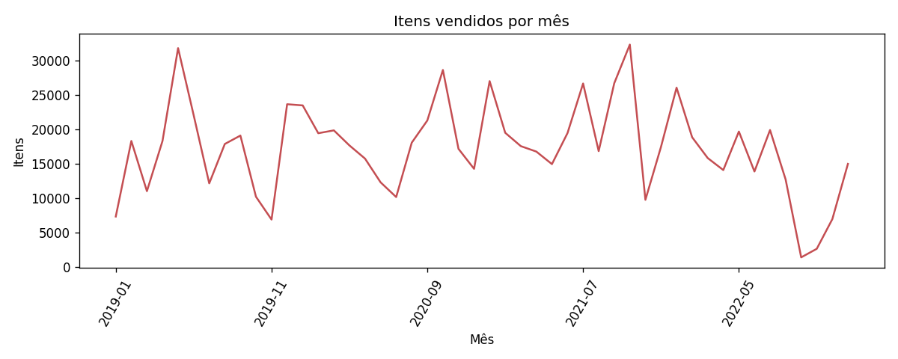
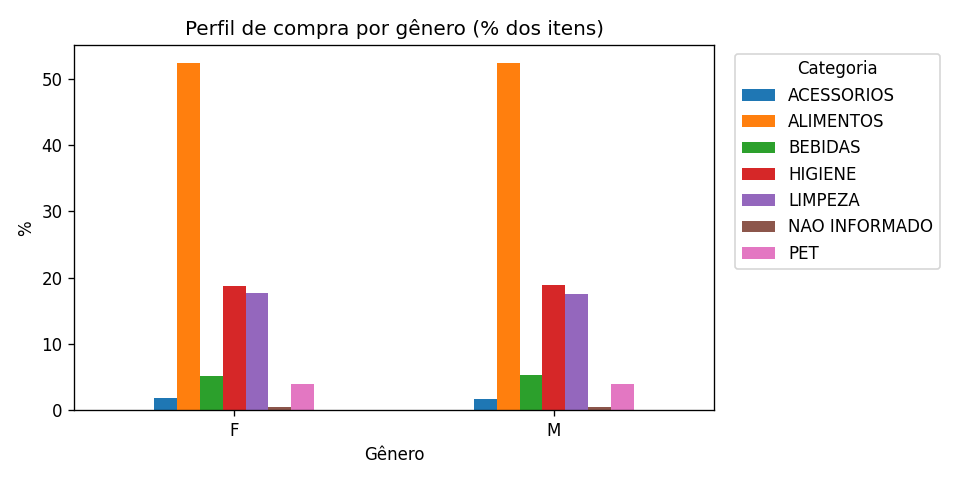

# Mini-projeto SCTEC — Análise Exploratória de Dados da base Varejo

**Autora:** Talita Luci da Silva  
**Turma:** Modelagem de Dados 525139

Este projeto executa uma análise exploratória (AED) da base Varejo com Python e pandas. O script documenta a leitura, o diagnóstico da qualidade, o tratamento de dados, as estatísticas descritivas, os agrupamentos e as conclusões.

## Estrutura

```text
Miniprojeto_TalitaLucidaSilva_ModelagemDeDados525139/
├── miniprojeto_varejo_aed.py
├── README.md
├── README_TalitaLucidaSilva_525139.md
└── saidas/
    ├── df_limpo.csv
    ├── 01_filhos.png
    ├── 02_categorias.png
    ├── 03_evolucao_mensal.png
    └── 04_genero_categoria.png
```

A base original não está incluída no ZIP porque tem aproximadamente 48 MB. Baixe `Base Varejo.csv` da página indicada no enunciado do curso e coloque-o na mesma pasta do script. A fonte sugerida é o [Kaggle — Base Varejo](https://www.kaggle.com/datasets/namespaiva/base-varejo/data).

## Como executar

Requer Python 3.9 ou superior.

```bash
pip install -r requirements.txt
python miniprojeto_varejo_aed.py
```

O script procura `Base Varejo.csv` na pasta do próprio script ou em uma pasta `data/`. Também é possível passar o caminho do arquivo:

```bash
python miniprojeto_varejo_aed.py "C:/caminho/Base Varejo.csv"
```

No Google Colab, envie o script e execute `%run miniprojeto_varejo_aed.py`. Se a base não for encontrada, o script solicita o upload.

A execução gera `saidas/df_limpo.csv` e os gráficos PNG. Se Matplotlib não estiver instalado, a análise textual continua funcionando.

## Etapas implementadas

| Requisito | Implementação |
|---|---|
| Manipulação de CSV | `pandas.read_csv()` e `DataFrame.to_csv()` |
| Documentação | Docstrings, comentários por Sprint e este README |
| Regras de negócio e datas | Validação de domínios, consistência de cadastros e `pd.to_datetime(errors="coerce")` |
| Tratamento de nulos e condicionais | Conversão de placeholders, `dropna()`, `fillna()` e preenchimento por cliente quando há valor conhecido |
| Estatísticas básicas | Média, mediana, desvio padrão, moda, mínimo, máximo e contagem de `CL_FHL` |
| Padrões de agrupamento | `groupby()` e `pivot_table()` por gênero, categoria, segmento, estado civil, número de filhos e tempo |
| Saídas e comunicação | Relatório no terminal, conclusões e gráficos opcionais |

## Decisões de tratamento e limitações

- **Colunas vazias:** quatro colunas residuais totalmente vazias são removidas.
- **Placeholders:** textos como `#N/D`, `N/A` e `NULL` são convertidos em valores ausentes.
- **Datas e chaves:** linhas sem data válida ou sem identificadores de nota/cliente são removidas, pois não podem ser usadas de forma confiável nas análises correspondentes.
- **Atributos de cliente:** quando há um valor conhecido em outra linha do mesmo cliente, ele é usado para preencher o campo ausente. Linhas que continuam sem os atributos exigidos são removidas.
- **Produto/categoria ausente:** os rótulos são preenchidos com `NAO INFORMADO`, sem inventar a categoria.
- **Linhas idênticas e `QTD`:** o script consolida registros idênticos e conta quantas vezes apareceram em `QTD`. Isso preserva a contagem original de 830.000 registros como unidades, **mas depende da hipótese de que as repetições representam unidades compradas**, e não duplicações acidentais da fonte. Essa hipótese precisa ser validada com o dicionário de dados ou com quem forneceu a base antes de usar os resultados para decisões operacionais.
- **Sem valores monetários:** a base não contém preço nem valor total; portanto, o projeto analisa contagem de itens e notas, não faturamento em reais.
- **Estatística de número de filhos:** a análise principal considera uma linha por cliente, pois `CL_FHL` é um atributo cadastral. Uma visão ponderada por itens também é exibida para comparação.
- **Escopo:** as conclusões descrevem a base disponível e não demonstram causalidade nem garantem representatividade de outros varejistas.


## Análise visual dos resultados

Os gráficos abaixo complementam as estatísticas impressas pelo script. As interpretações são descritivas e se referem somente à base analisada.

### 1. Distribuição de clientes por número de filhos



A distribuição concentra-se em clientes sem filhos: são 527 dos 1.000 clientes (52,7%). A média é de 1,14 filho por cliente, enquanto a mediana e a moda são iguais a zero. Isso mostra que a média, sozinha, não representa o perfil mais frequente da base.

### 2. Itens vendidos por categoria



ALIMENTOS é a categoria com maior participação, reunindo aproximadamente 52,4% dos itens contabilizados. Higiene e limpeza aparecem em seguida. Como a base não contém preço nem valor total, esse gráfico compara quantidades de itens, e não faturamento ou lucro por categoria.

### 3. Evolução mensal dos itens contabilizados



O gráfico apresenta a contagem mensal de itens ao longo do período disponível. Setembro e outubro de 2022 têm volumes muito inferiores aos meses correspondentes de anos anteriores. Isso pode indicar dados incompletos ou algum problema de coleta, mas o gráfico, por si só, não permite determinar a causa. É recomendável verificar a origem antes de interpretar tendências nesse período.

### 4. Participação das categorias por gênero



As participações das categorias são muito parecidas entre os grupos de gênero nesta base. A diferença descritiva não demonstra que o gênero cause determinado comportamento de compra, nem deve ser generalizada para outros públicos ou varejistas.

### Síntese e limitações

- A categoria ALIMENTOS concentra a maior quantidade de itens contabilizados.
- Mais da metade dos clientes registrados não tem filhos.
- A distribuição por gênero é relativamente equilibrada, e as participações por categoria são semelhantes.
- Os volumes baixos de setembro e outubro de 2022 merecem investigação.
- `QTD` é uma contagem inferida de linhas idênticas, pois a base não fornece uma quantidade explícita. A interpretação depende da hipótese de que as repetições representam unidades compradas.
- Não há valores monetários; portanto, não é possível concluir qual categoria gera mais receita ou lucro.

## Resultados da execução de referência

Na base anexada, o script leu 830.000 registros e 14 colunas; removeu quatro colunas totalmente vazias; consolidou 96.553 repetições exatas; e gerou uma base de 733.447 linhas, com `QTD` somando 830.000. A base final cobre o período de 04/01/2019 a 08/12/2022 e contém 1.000 clientes distintos.

- Mulheres representam 52,1% dos itens e homens 47,9% (diferença de 4,2 pontos percentuais).
- A categoria ALIMENTOS concentra 52,4% dos itens.
- Por cliente, `CL_FHL` tem média de 1,14 filho, mediana 0 e moda 0.
- Os totais mensais de setembro e outubro de 2022 são muito inferiores aos meses equivalentes de anos anteriores; vale investigar possível incompletude ou problema de coleta.
- A base não tem valor monetário e contém produtos sem nome/categoria identificáveis; essas limitações restringem as conclusões.

Os números acima correspondem à execução com o CSV fornecido e podem mudar se a base for atualizada.
